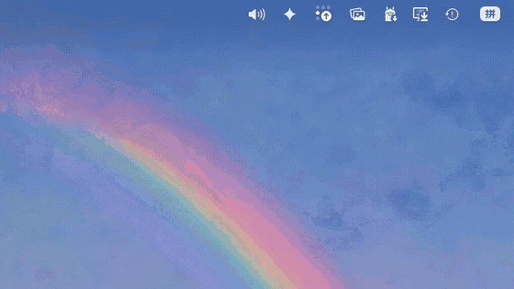
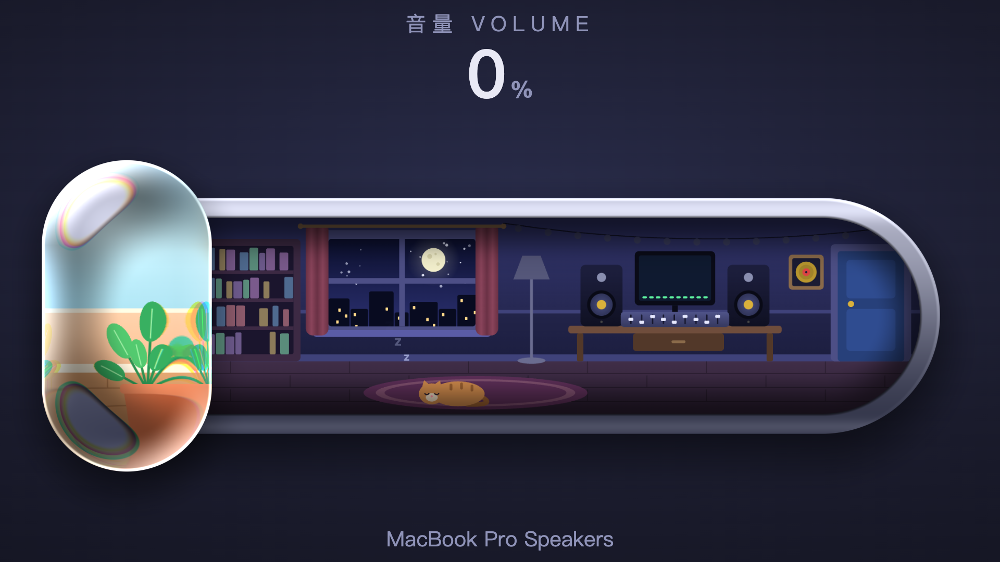
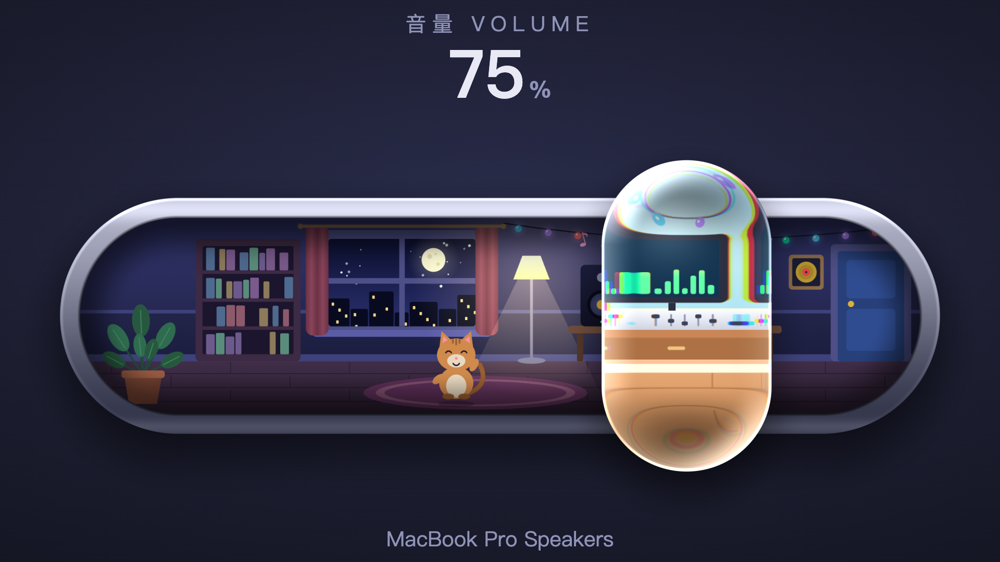
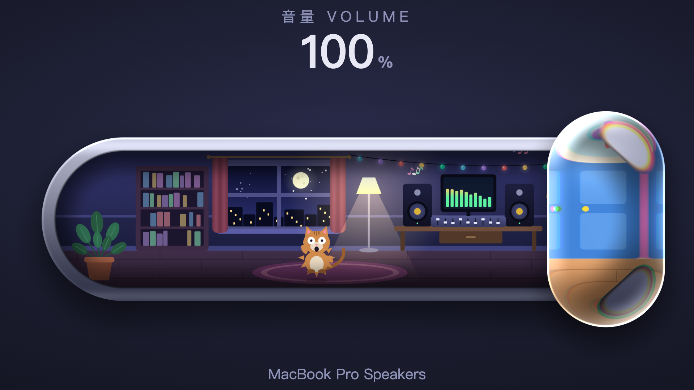
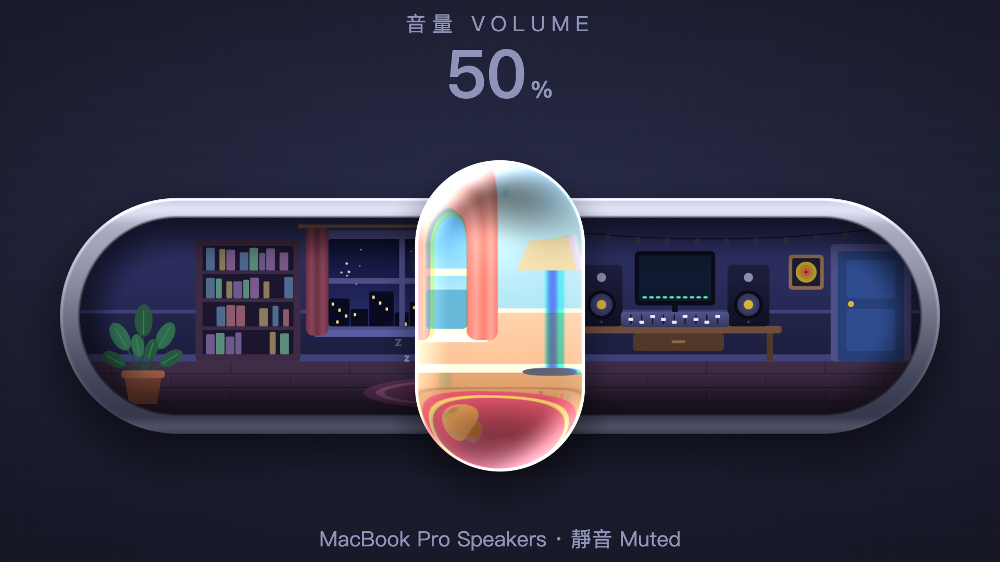
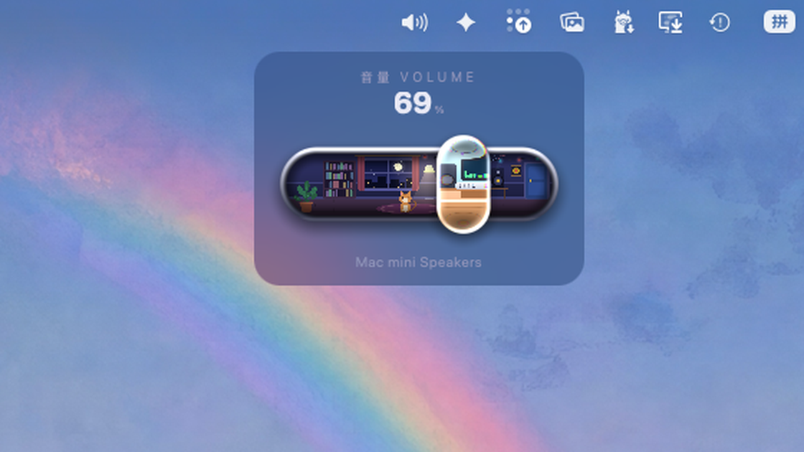

# UTUVO Volume

A liquid-glass volume slider for the macOS menu bar. Drag the glass and you are moving the real system volume — and the little recording studio inside the slider wakes up as it gets louder.

[繁體中文說明](README.zh-Hant.md)



## What it does

- **A real volume control.** It sets the volume of the current default output device through CoreAudio, and follows changes made anywhere else (keyboard, Control Center, switching devices).
- **Liquid glass.** The knob is a glass capsule rendered by a WebGL shader: it refracts the scene underneath, bends light harder toward the rim, splits colour slightly at the edge, lifts when pressed and squashes when thrown. Inside the glass you see the same room in daylight.
- **A room that reacts.** Low volume: the cat sleeps, the lamp is off. Higher: the lamp comes on, string lights blink, the speaker cones move, the cat sits up, dances, and at 100% gets a fright. Muted: lights out.
- **Replaces the system volume control.** With Accessibility permission it takes over the keyboard volume keys, so pressing them shows this slider instead of the system one. ⌥⇧ + volume key gives quarter steps, like macOS.
- **Custom global shortcuts** for volume up, volume down, mute and show/hide. These need no permission.
- **Small.** About the size of the system volume panel by default; medium and large are in the settings.
- **Built-in guide.** A step-by-step settings window (Chinese and English) walks through the permission, hiding the system Sound icon, and launch at login.

It makes no sound of its own and collects nothing.

| Quiet | Louder | Maximum |
|---|---|---|
|  |  |  |

| Muted | Actual size on the desktop |
|---|---|
|  |  |

The demo clip and the large stills are rendered frame by frame from the page the app displays (`scripts/render_demo.mjs`), so they show the slider only, larger than life. The last picture is a real screenshot of the app at its default size (230 pt wide).

## Install

Download the DMG from [Releases](../../releases), drag **UTUVO Volume** to Applications and open it. The guide opens on first launch; later, right-click the menu bar icon › **Settings & Guide**.

Requires macOS 13 or later. Universal (Apple silicon and Intel).

## Good to know

- **Some outputs cannot be adjusted in software.** Many audio interfaces, and HDMI or DisplayPort monitors, fix their level in hardware. On those the slider greys out, says so, and hands the volume keys back to the system.
- The animation follows the volume level on a fixed tempo. It does not listen to what you are playing.
- To undo everything: right-click the icon › Quit. The volume keys go back to macOS immediately.

## Build

```bash
scripts/build.sh
```

This regenerates `Resources/slider.html` from `prototype/glass.html`, compiles for arm64 and x86_64 with `swiftc`, assembles the app in `build/` and signs it ad hoc. No Xcode project, no dependencies.

To sign with your own Developer ID and notarize:

```bash
SIGN_IDENTITY="Developer ID Application: Your Name (TEAMID)" NOTARY_PROFILE="your-notarytool-profile" scripts/build.sh --release
```

## How it is put together

| Path | What |
|---|---|
| `prototype/glass.html` | The slider itself: scene drawing on canvas, the glass shader, spring physics. Opens in any browser, where it also plays a small synthesized loop. |
| `prototype/index.html` | The first, pixel-art version. |
| `scripts/make_page.py` | Turns the prototype into the in-app page: no audio, bridged to the native side. |
| `Sources/SystemVolume.swift` | CoreAudio: read, write and observe volume and mute on the default output. |
| `Sources/App.swift` | Menu bar item, the floating panel, the media-key event tap, global shortcuts, the guide window. |
| `Resources/guide.html` | The settings and guide window. |

Self-checks, for a machine where you do not mind the volume moving for a second: `"build/UTUVO Volume.app/Contents/MacOS/UTUVO Volume" --selftest-set`.

## Credits

The idea of a tiny room inside a volume slider came from a demo posted by @vib3coded on Threads. Everything here was written from scratch.

## License

MIT — see [LICENSE](LICENSE).
