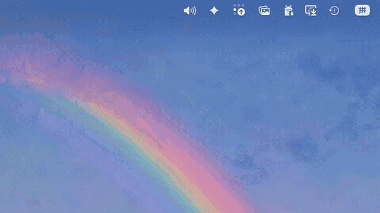
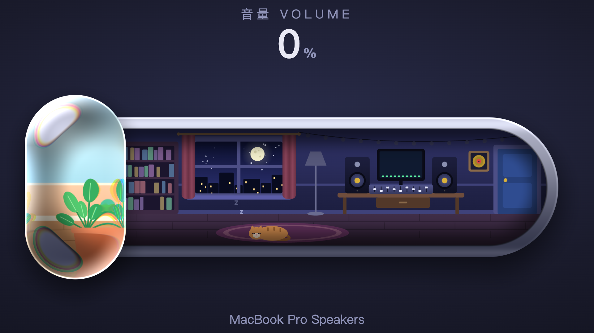
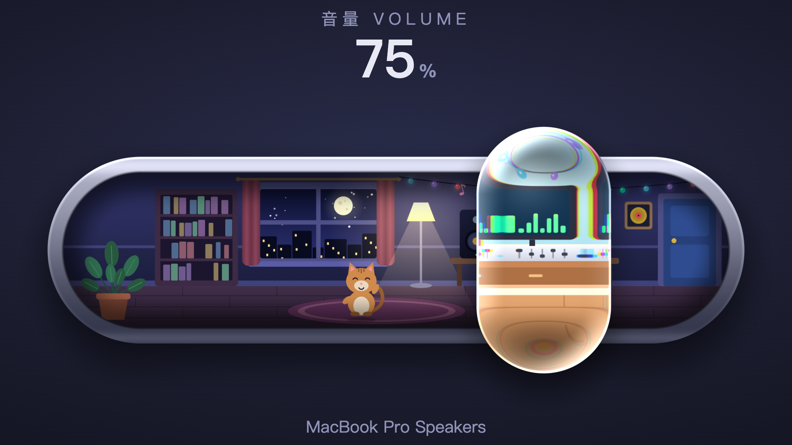
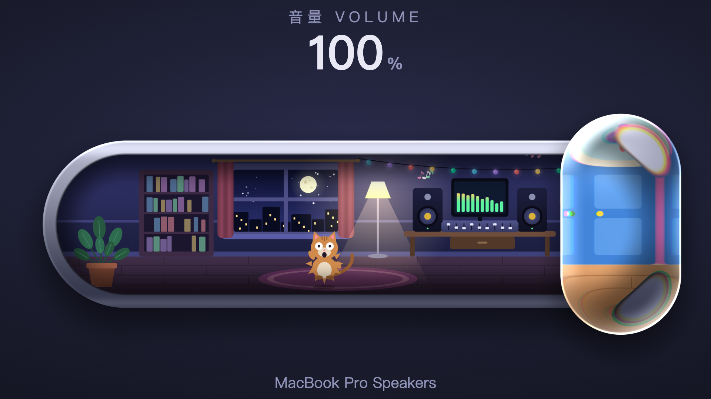
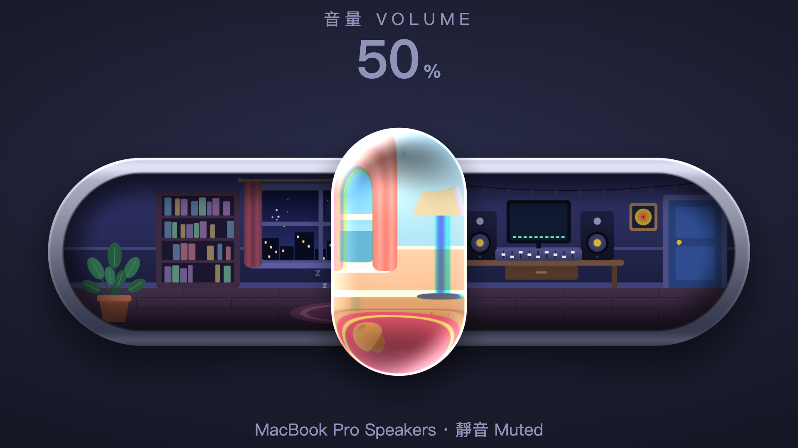
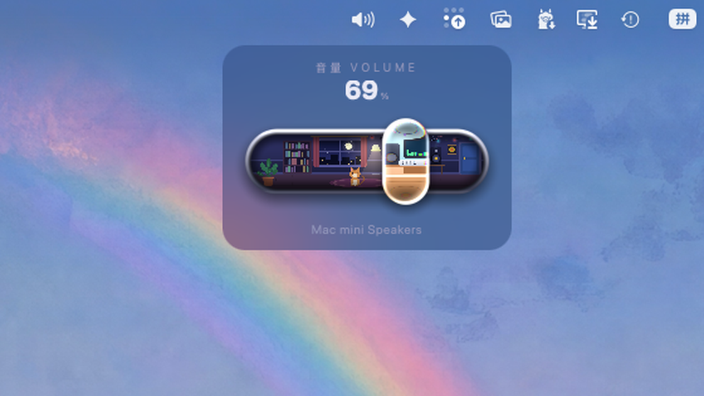

# UTUVO Volume

放在 macOS 選單列上的液態玻璃音量滑桿。拖那顆玻璃，動的就是真正的系統音量；滑桿裡那間小錄音室，會隨著音量變大而熱鬧起來。

[English](README.md)



## 它會做什麼

- **真的在調音量。** 透過 CoreAudio 設定目前預設輸出裝置的音量，別的地方改了（鍵盤、控制中心、換裝置）它也會跟著動。
- **液態玻璃。** 推子是一顆用 WebGL shader 算出來的玻璃膠囊：會折射底下的畫面，越靠邊緣光彎得越厲害，邊緣有一點色散，按住會浮起來，甩快會被拉扁。玻璃裡看到的是同一間房間的白天。
- **房間會有反應。** 音量小：貓在睡、燈沒開。往上：立燈亮、串燈閃、喇叭單體動、貓坐起來、跳舞，開到 100% 會嚇到炸毛。靜音：整間熄燈。
- **可以取代系統的音量調節。** 給它「輔助使用」權限後，鍵盤的音量鍵就歸它管，按下去出來的是這條滑桿。⌥⇧＋音量鍵是四分之一格的細調，跟 macOS 一樣。
- **自訂全域快速鍵**：音量大、音量小、靜音、打開／收起。這部分不需要任何權限。
- **很小。** 預設跟系統的音量面板差不多大，設定裡可以改成中或大。
- **內建教學。** 設定視窗一步一步帶你做完：給權限、把系統的聲音圖示收起來、登入時啟動（中英文都有）。

它自己不會發出任何聲音，也不收集任何資料。

| 小聲 | 大聲一點 | 開到底 |
|---|---|---|
|  |  |  |

| 靜音 | 在桌面上的實際大小 |
|---|---|
|  |  |

示範影片和大張截圖，是把 App 顯示的那一頁逐格算出來的（`scripts/render_demo.mjs`），所以畫面裡只有滑桿。最後一張是 App 預設大小的真實螢幕截圖。

## 安裝

到 [Releases](../../releases) 下載 DMG，把 **UTUVO Volume** 拖進「應用程式」後打開。第一次開會自動出現教學；之後對選單列圖示按右鍵 ›「設定與教學」。

需要 macOS 13 以上，Apple 晶片與 Intel 都能用。

## 先知道比較好

- **有些輸出裝置沒辦法用軟體調音量。** 很多錄音介面、HDMI 或 DisplayPort 螢幕的音量是固定在硬體上的。遇到這種裝置，滑桿會變淡並告訴你，音量鍵也會自動交還給系統。
- 動畫是跟著音量大小、用固定速度在動，不會去聽你正在播什麼。
- 想全部還原：對圖示按右鍵 ›「結束」，音量鍵立刻回到 macOS 手上。

## 自己編譯

```bash
scripts/build.sh
```

它會從 `prototype/glass.html` 重新產生 `Resources/slider.html`，用 `swiftc` 編出 arm64 與 x86_64，在 `build/` 組成 App 並做 ad hoc 簽章。沒有 Xcode 專案，沒有任何相依套件。

要用自己的 Developer ID 簽章並公證：

```bash
SIGN_IDENTITY="Developer ID Application: Your Name (TEAMID)" NOTARY_PROFILE="your-notarytool-profile" scripts/build.sh --release
```

## 結構

| 路徑 | 內容 |
|---|---|
| `prototype/glass.html` | 滑桿本體：canvas 畫場景、玻璃 shader、彈簧物理。用瀏覽器直接開就能玩（網頁版會播一小段合成音樂）。 |
| `prototype/index.html` | 最早的像素風版本。 |
| `scripts/make_page.py` | 把原型轉成 App 內用的頁面：拿掉聲音、接上原生端。 |
| `Sources/SystemVolume.swift` | CoreAudio：讀、寫、監聽預設輸出的音量與靜音。 |
| `Sources/App.swift` | 選單列圖示、浮動面板、攔截鍵盤音量鍵、全域快速鍵、教學視窗。 |
| `Resources/guide.html` | 設定與教學視窗。 |

## 致謝

「音量滑桿裡面有一間小房間」這個點子，來自 @vib3coded 在 Threads 上貼的一段示範。這裡的程式全部是從零寫的。

## 授權

MIT，見 [LICENSE](LICENSE)。
